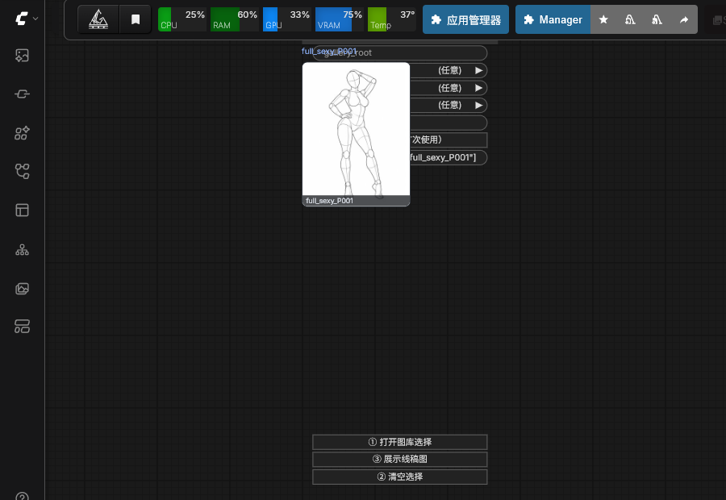
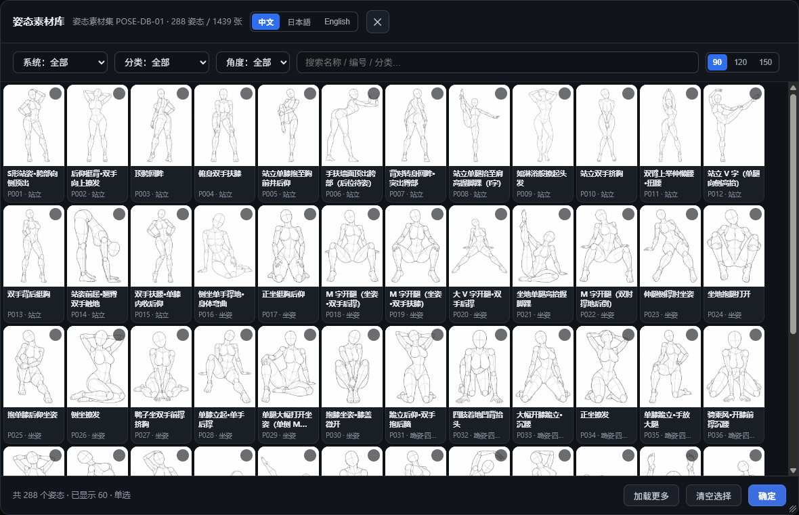
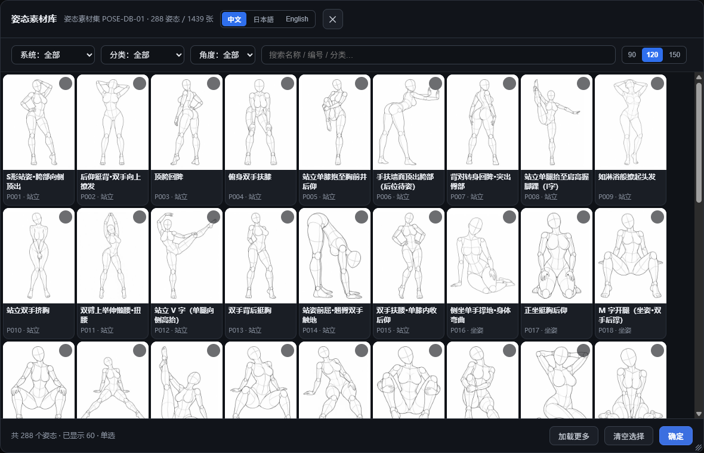
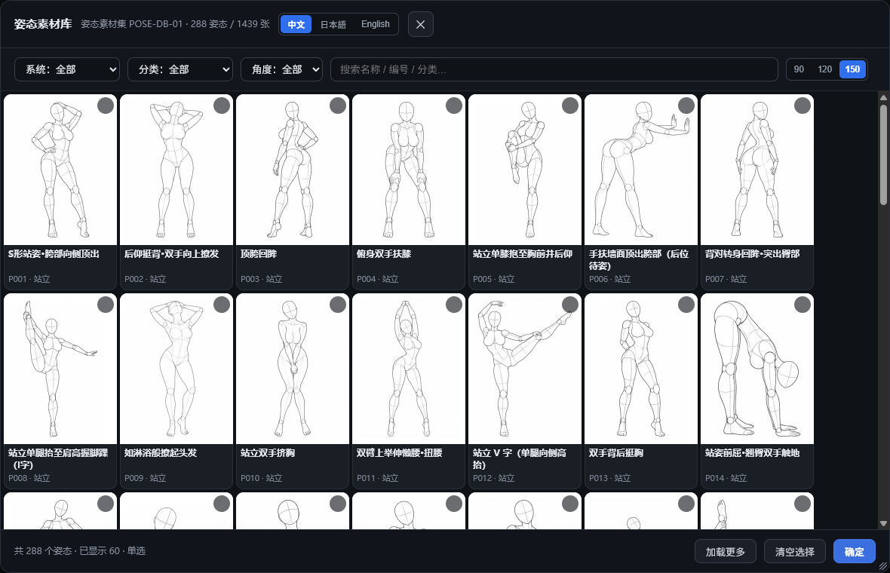

# ComfyUI Pose Gallery

把**本地姿态素材库**接进 ComfyUI：可视化挑姿态，直接把线稿图接进生成流程。

Browse a **local pose-reference library** inside ComfyUI and feed the chosen
line-art sketches straight into your generation graph.

**[中文](#中文) · [English](#english) · [工作流说明 / Workflows](workflows/README.md)**

> **更新日期 / Updated**: 2026-10-29

---

## 三个核心功能 / Three Highlights

### 1. 可视化姿态图库，288 姿态 / 1439 张图 / 0 个下拉框

点节点上的按钮弹出图库面板，按系统、分类、角度筛选，关键词搜索，缩略图即点即选。
**不把整个素材库塞进下拉框**，所以条目再多也不卡。

A visual gallery panel with system / category / angle filters and keyword
search. Click a thumbnail to select it — nothing is crammed into a combo box,
so hundreds of entries stay fast.

### 2. 选中即在节点上看到线稿，无需反复开关面板

选完姿态，线稿图**直接渲染在节点上**（批量节点最多显示 4 张，带 `+N` 标记），
确认姿态对不对不用再重新打开面板。

The selected line-art sketch renders **directly on the node** (up to 4 on batch
nodes, with a `+N` badge), so you can verify the pose without reopening the panel.

### 3. 缩略图严格 3:4，三档宽度，面板可自由缩放

素材原图是 3:4，缩略图**严格按 3:4 渲染**，提供 **90 / 120 / 150 px** 三档宽度；
面板右下角可拖拽拉宽拉高，尺寸自动记忆，一次能看更多姿态。

Thumbnails keep the assets' native **3:4** aspect at three width presets
(**90 / 120 / 150 px**). The panel is freely resizable via a corner grip and
remembers its size.

---

## 截图 / Screenshots


*图库面板：288 姿态 / 1439 张图，三档缩略图宽度，可拖拽缩放*
*Gallery panel: 288 poses / 1439 images, three thumbnail presets, resizable*



*节点布局：参数 → 15px 留白 → ①②③ 按钮 → 三张线稿（90×120，紧贴③下方）→ 下载按钮（含姿态/图片计数）*
*Node layout: parameters → 15px gap → buttons ①②③ → three 90×120 sketches under ③ → download button with counts*

<details>
<summary>三档缩略图宽度对比 / Thumbnail width presets</summary>

| 90 px | 120 px | 150 px |
| --- | --- | --- |
|  |  |  |

</details>

---

## 中文

### 这是什么

一个 ComfyUI 自定义节点包。本身**不含任何素材**，而是一个「姿态库浏览器 + 读取器」：

- 读一份本地 JSON 索引（描述有哪些姿态、每个姿态对应哪几张角度的图片）
- 在 ComfyUI 里提供可视化选择面板
- 把选中的图片读成 `IMAGE` 张量，同时输出编号 / 名称 / 路径等元信息

**装上即可用**：节点上有「⤓ 下载素材（首次使用）」按钮，点一下自动把素材从原站下载到你的本机。

### 五个节点

| 节点 | 用途 |
| --- | --- |
| **姿态库 · 单张** | 取 1 个姿态的 1 个角度 |
| **姿态库 · 角度组（5 角度）** | 取同一姿态的多个角度作为批次 |
| **姿态库 · 批量** | 按系统/分类/关键词批量取，或直接传多个 `pose_id` |
| **姿态库 · 从批次取单张** | 从批次中按序号取一张，元信息同步取出 |
| **姿态库 · 姿态描述提示词** | 从批次的 `META_JSON` 取第 N 个姿态，输出「体位 + 名称」提示词文本，用于拼接进生图提示词；批量出图时每条分支接一个即可显著提升线稿还原度 |

**输出口**：`IMAGE` / `META_JSON` / `IMAGE_IDS` / `PATHS` / `NOTE`，四者严格一一对应。

### 安装

1. 把本目录放到 `ComfyUI/custom_nodes/` 下
2. **重启 ComfyUI**，并刷新浏览器页面
3. 首次使用点节点上的「⤓ 下载素材（首次使用）」

素材也可手动准备：在 `config.json` 写 `{"gallery_root": "<素材库根目录>"}`
（需含 `data/`、`thumbs/`、`img/`），或设环境变量 `POSE_GALLERY_ROOT`。

### 图库面板用法

节点上有三个按钮：

- **① 打开图库选择** —— 弹出面板，筛选 / 搜索 / 点图即选（批量节点可多选）
- **② 清空选择**
- **③ 展示线稿图** —— 把已选姿态的线稿渲染到节点上

**缩略图档位**：筛选栏右侧 `90 / 120 / 150` 即时切换，选择会被记住。

**面板缩放**：拖右下角手柄可拉宽拉高，最小 520×320，尺寸自动记忆。

**界面语言**：中文 / 日本語 / English，默认中文，切换即时生效且记住选择。

### 接入生图（实测示例）

> **更新日期：2026-10-29** ｜ 详细说明见 **[workflows/README.md](workflows/README.md)**

仓库 `workflows/` 下有两个实测可用的工作流（基于 **Qwen-Image-2.1**）：

| 文件 | 说明 | 耗时（2080 Ti 22GB） |
| --- | --- | --- |
| [`workflows/pose-to-qwen-single.json`](workflows/pose-to-qwen-single.json) | 单张：选 1 个姿态 → 生成 1 张 | 约 12–26 秒 |
| [`workflows/pose-to-qwen-batch.json`](workflows/pose-to-qwen-batch.json) | 批量：面板里选 N 张 → 逐张独立参考，一次生成 N 张 | 约 58–78 秒 / 3 张 |

两份工作流的**节点结构、参数、避坑说明、改张数的方法**都写在
**[workflows/README.md](workflows/README.md)** 里，这里只讲最关键的结论。

链路：

```text
PoseGalleryBatchLoader           (本插件，一次取多张线稿)
        ↓ 每张单独切出
ImageFromBatch(i) → TextEncodeQwenImage21 → KSampler → VAEDecode
        ↑
PoseGalleryPosePrompt(i)         (把该姿态名称拼进提示词)
        ↓
ImageBatch → SaveImage
```

> **为什么批量必须逐张独立参考**
>
> `TextEncodeQwenImage21` 的实现是 `samples = image[:1]`——只读取传入批次的第一张。
> 所以「一个 BatchLoader → 一个 TextEncode → `RepeatLatentBatch(N)`」这种接法里，
> N 张产出全部只参考第 1 张线稿，后几张是拿第 1 张的条件配不同噪声自由发挥。
> 表现为「只有第一张姿态对，后面全错」，且换几次结果都一样，不是随机性。
> 正确做法是每条分支各自 `ImageFromBatch` 切一张、各自编码。

**批量要点**：仓库里的批量工作流共 **3 条分支**。要出别的张数，复制一条分支后同时改两处——
该分支 `ImageFromBatch` 的 `batch_index` 与 `PoseGalleryPosePrompt` 的 `index`，
两者都要等于这张图在 `pose_ids` 里的位置（从 0 起算）。每条分支用各自的 seed。

> 这两个工作流依赖 Qwen-Image-2.1 相关模型，需自行准备。姿态素材可换成任意来源。

### 已知限制

- 姿态图是**线稿人体模型**，DWPose / OpenPose 等骨骼检测节点**无法识别**
  （它们依赖真实人体特征）。需要骨骼控制时，请改用「线稿 → 视觉模型转文字 → 合并提示词」路线。
- 插件不含素材，素材著作权归原作者，使用前请阅读 [ATTRIBUTION.md](ATTRIBUTION.md)。

### 数据来源与授权

素材著作权归原作者 **ギア**（<https://x.com/giaaibusi>）所有。
允许作品制作中的商用/编辑/参考使用；**禁止再分发、转载、转售图像数据本身**。

本仓库**不包含任何图片或姿态数据**，只包含读取工具（代码）。

### 许可证

代码以 [MIT](LICENSE) 发布。

---

## English

### What it is

A ComfyUI custom-node package. It ships **no assets** — it is a *pose-library
browser + reader*:

- reads a local JSON index describing poses and their per-angle images
- provides a visual picker inside ComfyUI
- loads the selected images as `IMAGE` tensors and exposes ids / names / paths

**Works right after install**: click "⤓ Download assets (first run)" on any node
to fetch the library onto your own machine.

### The five nodes

| Node | Purpose |
| --- | --- |
| **Pose Gallery · Single** | one pose, one angle |
| **Pose Gallery · Angle Set (5 angles)** | several angles of one pose as a batch |
| **Pose Gallery · Batch** | batch by system/category/keyword, or pass multiple `pose_id`s |
| **Pose Gallery · Pick One** | pick one item out of a batch, metadata stays in sync |
| **Pose Gallery · Pose Prompt** | read item N out of a batch's `META_JSON` and emit a "posture + name" prompt string; add one per branch in batch generation to markedly improve how faithfully the sketch is followed |

**Outputs**: `IMAGE` / `META_JSON` / `IMAGE_IDS` / `PATHS` / `NOTE`, strictly aligned.

### Install

1. Drop this folder into `ComfyUI/custom_nodes/`
2. **Restart ComfyUI** and refresh the browser page
3. On first use, click "⤓ Download assets (first run)"

You can also bring your own library: set `{"gallery_root": "<root>"}` in
`config.json` (must contain `data/`, `thumbs/`, `img/`) or set `POSE_GALLERY_ROOT`.

### Using the picker

Three buttons on every gallery node:

- **① Open picker** — panel with filters, search, click-to-select (multi-select on batch nodes)
- **② Clear selection**
- **③ Show sketch** — render the selected sketches inline on the node

**Thumbnail presets**: `90 / 120 / 150` on the right of the filter bar; the choice is remembered.

**Panel resizing**: drag the bottom-right grip to resize (min 520×320); the size is remembered.

**UI language**: Chinese / Japanese / English, Chinese by default, switches live and persists.

### Wiring it into generation (verified example)

> **Updated: 2026-10-29** ｜ full details in **[workflows/README.md](workflows/README.md)**

Two verified workflows ship in `workflows/` (built on **Qwen-Image-2.1**):

| File | Description | Time (2080 Ti 22GB) |
| --- | --- | --- |
| [`workflows/pose-to-qwen-single.json`](workflows/pose-to-qwen-single.json) | one pose → one image | ~12–26 s |
| [`workflows/pose-to-qwen-batch.json`](workflows/pose-to-qwen-batch.json) | pick N sketches in the panel → N independent references, N images | ~58–78 s for 3 |

Node structure, parameters, pitfalls and how to change the branch count live in
**[workflows/README.md](workflows/README.md)**; only the key conclusion is repeated here.

Graph:

```text
PoseGalleryBatchLoader           (this plugin, fetches several sketches)
        ↓ one per branch
ImageFromBatch(i) → TextEncodeQwenImage21 → KSampler → VAEDecode
        ↑
PoseGalleryPosePrompt(i)         (splices that pose's name into the prompt)
        ↓
ImageBatch → SaveImage
```

> **Why a batch needs one reference per branch**
>
> `TextEncodeQwenImage21` does `samples = image[:1]` — it reads only the first image
> of whatever batch it receives. So the common wiring
> "one BatchLoader → one TextEncode → `RepeatLatentBatch(N)`" makes all N outputs
> reference the first sketch only; the rest are that same conditioning driven by
> different noise. The symptom is "only the first pose is right, the rest are wrong",
> reproducibly — not randomness. Give each branch its own `ImageFromBatch` slice.

**Batch note**: the shipped batch workflow has **three** branches wired this way. To
emit a different count, copy a branch and change that `ImageFromBatch`'s `batch_index`
and its `PoseGalleryPosePrompt`'s `index`; both must match the sketch's position
(0-based) inside `pose_ids`. Each branch also reuses its own seed.

> Both workflows expect the Qwen-Image-2.1 model set, which you must provide.
> The pose assets can be swapped for any other source.

### Known limits

- The library contains **line-art mannequins**, so skeleton detectors
  (DWPose / OpenPose) **cannot parse them** — they rely on real human features.
  For skeletal control, use a "sketch → vision-model caption → merge prompt" route instead.
- No assets are bundled; asset copyright belongs to the original author — see
  [ATTRIBUTION.md](ATTRIBUTION.md).

### Data & attribution

Asset copyright belongs to **ギア** (<https://x.com/giaaibusi>).
Commercial/editorial/reference use in creating works is allowed;
**redistributing, reposting or reselling the image data itself is prohibited**.

This repository ships **no images or pose data** — only the reading tool (code).

### License

Code released under the [MIT](LICENSE) license.
